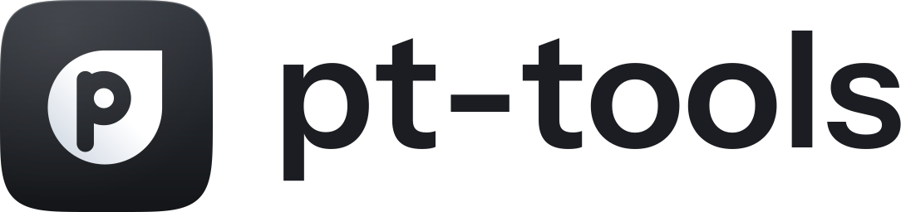

# pt-tools — brand assets

> 中文版本：[README.zh.md](./README.zh.md)

The pt-tools 1.0 mark: a white seed with a lowercase p cut out of it, on an ink
superellipse badge. The paper version is the inverse: an ink seed on a white badge.

Every file in this directory except `build.py`, `fonts/` and the two READMEs is
generated by `build.py`. Do not edit the outputs by hand; change `build.py` and regenerate:

```sh
uv run --with fonttools==4.65.0 --with shapely==2.2.0 --with cairosvg==2.7.1 python3 build.py
```

The versions are pinned because the outputs were checked byte for byte against the
approved design files, and another shapely release (it bundles its own GEOS) or
fontTools release can move the last digit of a coordinate.

## Why this mark

- The user chose it on 2026-11-18 from the third round of 1.0 logo designs: concept
  23, 种子徽标 (seed badge), in palettes A 墨黑 (ink) and C 纯白 (paper).
- The earlier mark, a shell prompt caret followed by a cursor block, only said
  "command-line tool". pt-tools 1.0 is a self-hosted service with a web UI, a mobile
  app and an AI assistant.
- The user rejected orange and brown accents and asked for black, white and a
  restrained blue. This mark uses black, white and greys only.
- Chinese PT users call a torrent a 种子, a seed; the p is for pt. The design round
  noted one risk: the outline, a circle with one corner, can be read as a speech
  bubble.

## Construction

All numbers are units of the 1024 × 1024 canvas.

| Part | Ink | Paper |
| --- | --- | --- |
| Plate shape | superellipse \|x\|⁵ + \|y\|⁵ = 1 scaled to the canvas, 360 points | same |
| Plate fill | vertical gradient `#31353C` → `#131518` | vertical gradient `#FFFFFF` → `#EEF1F5` |
| Plate light | white radial glow centred at (300, 150), radius 820, 10 % → 0; top-edge highlight: the outline stroked 10 wide and clipped to the plate, white 22 % at the top, gone by half height | none |
| Plate edge | none | `#DCE1E8` rim: the outline stroked 8 wide and clipped to the plate |
| Seed fill | diagonal gradient from the bottom-left corner of its box to the top-right one: `#C9D2DE` → `#FFFFFF` at 55 % → `#FFFFFF` | `#3D424C` → `#1B1D22` at 55 % → `#1B1D22` |

The seed:

- A 640 disc united with its top-right quadrant square, so it is round except for one
  corner at the top right.
- The p is a 96 stroke: a bowl (a ring with centre-line radius 104, so ink from radius
  56 to 152) and a stem with round ends. The stem's left edge lines up with the bowl's
  leftmost point and its right edge touches the counter. The p is cut out of the seed
  and lies wholly inside it, so the outline never opens; the counter stays as an
  island of seed.
- Ink box at scale 1: (184, 200)–(824, 840), 640 × 640, shifted 8 left and 8 down
  from the canvas centre as an optical correction for the corner.

Glyph scale, about the canvas centre:

- 0.86 in `logo.svg`, `logo-dark.svg`, `app-icon.svg` and the lockups. Ink box
  (229.9, 243.7)–(780.3, 794.1).
- 1.0 in `favicon.svg`, `favicon-dark.svg` and `logo-mono.svg`. The favicons are for
  16 and 32 px, where the larger glyph keeps the cut 1.5 px wide at 16 px instead of
  1.3 px.

The app icon is a full-bleed square with the plate gradient and glow only, for
platforms that apply their own mask: iOS, Android adaptive icons, PWA maskable icons.
The farthest ink, the seed's corner, is 379.5 from the centre, inside a 440 safe
radius, so a round mask does not clip it.

The lockup is the badge at 256 px, a 72 px gap, then "pt-tools" in Instrument Sans
SemiBold (600) at 196 px, converted to outlines, with its x-height band centred on
the badge: 1084 × 256 in all. The type is `#1B1D22` in `wordmark-light.svg` and
`#F1F2F4` in `wordmark.svg`.

## Files

| File | What it is | Use it for |
| --- | --- | --- |
| `logo.svg` | ink badge, glyph 0.86 | light surfaces, above 32 px |
| `logo-dark.svg` | paper badge, glyph 0.86 | dark surfaces, above 32 px |
| `favicon.svg` | ink badge, glyph 1.0 | light surfaces at 16–32 px; the SVG favicon |
| `favicon-dark.svg` | paper badge, glyph 1.0 | dark surfaces at 16–32 px |
| `app-icon.svg` | ink, full-bleed square | iOS app icon, Android adaptive icon, PWA maskable icon |
| `logo-mono.svg` | the seed alone, glyph 1.0, `currentColor` | inline in text or UI that sets its own colour |
| `wordmark-light.svg` | lockup: ink badge, dark type | light surfaces |
| `wordmark.svg` | lockup: paper badge, light type | dark surfaces |
| `icon-16.png`, `icon-32.png` | ink, rendered from `favicon.svg` | PNG and ICO favicons |
| `icon-64.png` … `icon-512.png` | ink, rendered from `logo.svg` | extension icons, NAS app centres, avatars, social previews |

The rule: **ink on light surfaces, paper on dark surfaces.** A place that takes a
single image and cannot follow the theme uses ink: app icons, the browser extension,
NAS app centres, PNG and ICO favicons, registry avatars.

Where the page can switch, pair the two. In a GitHub README:

```html
<picture>
  <source media="(prefers-color-scheme: dark)" srcset="wordmark.svg">
  
</picture>
```

The PNGs are RGBA, transparent outside the plate, and each is rendered at its own
size rather than scaled from a larger one. For a size not in the ladder, render the
matching SVG at that size: `favicon.svg` at 32 px and below, `logo.svg` above (48 px
for a browser extension), and `app-icon.svg` wherever the platform applies its own
mask (an Apple touch icon, an Android launcher icon). Do not scale a PNG.

Each SVG has its own id prefix (`pt-23-seed-ink`, `pt-23-seed-paper-fav`,
`lk-23-seed-ink-1b1d22`, …), so different files can be inlined into one page.
Inlining the same file twice needs unique ids per copy; firlab's
`src/components/AppIcon.astro` does this for the ink badge.

## Rules

- **Do not hand-edit the outputs.** Change `build.py` and regenerate. Other
  repositories copy these files byte for byte.
- **Do not add effects** beyond what `build.py` draws: no shadows, outer glows,
  outlines, extra gradients or opacity changes.
- **Do not recolour.** Use the two palettes as they are: no orange, no brown, no
  tinted seed, no paper seed on an ink plate.
- **Do not stretch, rotate or mirror.** Scale uniformly; the seed's corner points up
  and to the right.
- **Minimum sizes:** the badge 16 px, using the favicon files at 32 px and below;
  `logo-mono.svg` 16 px; the lockups 24 px tall (about 102 px wide). Below 24 px the
  p in the lockup's badge closes up.
- **Do not set the name in a live font** next to the badge. Use a lockup; its type
  is outlines and renders the same on a machine without the font.

## Font

`fonts/InstrumentSans-600.ttf` is Instrument Sans at weight 600: a static instance
with a Latin subset of 244 glyphs, copyright 2022 The Instrument Sans Project
Authors, under the SIL Open Font License 1.1 (`fonts/OFL.txt`; its notice names no
Reserved Font Name). Only `build.py` reads it, to convert the lockup text to outlines.
No output embeds the font.

## Licence

The mark and these files belong to the pt-tools project and carry its licence (MIT)
unless stated otherwise. The font is under the OFL, as above.
