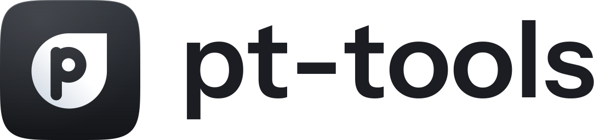

# pt-tools — 品牌资源

> English version: [README.md](./README.md)

pt-tools 1.0 的标志：墨黑的超椭圆底板上，一颗白色的种子，种子中间镂空一个小写 p。
纯白版是反过来的：白色底板上一颗墨黑的种子。

这个目录里除了 `build.py`、`fonts/` 和两份 README，其余文件都由 `build.py` 生成。不要手改生成的
文件；要改就改 `build.py`，然后重新生成：

```sh
uv run --with fonttools==4.65.0 --with shapely==2.2.0 --with cairosvg==2.7.1 python3 build.py
```

版本号是钉死的：生成结果和定稿的设计文件逐字节比对过，换一个 shapely 版本（它自带
GEOS）或 fontTools 版本，坐标的最后一位就可能变。

## 为什么是这个标志

- 用户在 2026-11-18 从 1.0 logo 第三轮设计里选定：23 号「种子徽标」，配色 A 墨黑
  和 C 纯白。
- 上一版标志是 shell 提示符的尖括号加一个光标块，只说明了「命令行工具」。pt-tools
  1.0 是一个自托管服务，有网页界面、手机 App 和 AI 助手。
- 用户否掉了橙色和棕色，方向是黑、白和克制的蓝。这个标志只用黑、白和灰。
- PT 圈把 torrent 叫种子；p 是 pt。设计稿里记下的风险：轮廓是带一个尖角的圆，有人会
  当成聊天气泡。

## 构造

下面的数字都是 1024 × 1024 画布上的单位。

| 部件 | 墨黑 | 纯白 |
| --- | --- | --- |
| 底板形状 | 超椭圆 \|x\|⁵ + \|y\|⁵ = 1 缩放到画布，360 个点 | 同左 |
| 底板填充 | 竖向渐变 `#31353C` → `#131518` | 竖向渐变 `#FFFFFF` → `#EEF1F5` |
| 底板光感 | 白色径向光晕，圆心 (300, 150)，半径 820，不透明度 10 % → 0；顶边高光：轮廓描边 10 宽、裁在底板内，顶部白色 22 %，到一半高度消失 | 无 |
| 底板边缘 | 无 | `#DCE1E8` 描边：轮廓描边 8 宽、裁在底板内 |
| 种子填充 | 对角渐变，从包围盒左下角到右上角：`#C9D2DE` → 55 % 处 `#FFFFFF` → `#FFFFFF` | `#3D424C` → 55 % 处 `#1B1D22` → `#1B1D22` |

种子：

- 一个直径 640 的圆，并上它右上四分之一的正方形，所以整体是圆的，只有右上角是一个
  尖角。
- p 的笔画宽 96：碗是一个圆环（中线半径 104，墨迹从半径 56 到 152），竖笔两端是圆头。
  竖笔左边缘和碗的最左点对齐，右边缘贴着碗里的空心。p 从种子上镂空，整个落在种子里面，
  所以外轮廓不会被切开；碗里的空心留成一块独立的种子。
- 缩放 1.0 时的墨迹范围：(184, 200)–(824, 840)，640 × 640，相对画布中心向左 8、向下 8，
  这是给右上尖角做的视觉修正。

图形缩放，以画布中心为原点：

- 0.86：`logo.svg`、`logo-dark.svg`、`app-icon.svg` 和两个字标。墨迹范围
  (229.9, 243.7)–(780.3, 794.1)。
- 1.0：`favicon.svg`、`favicon-dark.svg` 和 `logo-mono.svg`。favicon 只用在 16 和
  32 px，图形放大一号后，16 px 下镂空的笔画是 1.5 px 宽，而不是 1.3 px。

App 图标是满版的正方形，只有底板渐变和光晕，给自己加遮罩的平台用：iOS、Android
自适应图标、PWA maskable 图标。离中心最远的墨迹是种子的尖角，距离 379.5，在 440 的
安全半径以内，圆形遮罩不会切到它。

字标是 256 px 的徽标、72 px 的间距，再接 Instrument Sans SemiBold（600）196 px 的
「pt-tools」，文字已转成轮廓，x 高度那一段和徽标垂直居中对齐：整体 1084 × 256。文字
颜色在 `wordmark-light.svg` 里是 `#1B1D22`，在 `wordmark.svg` 里是 `#F1F2F4`。

## 文件

| 文件 | 是什么 | 用在哪 |
| --- | --- | --- |
| `logo.svg` | 墨黑徽标，图形 0.86 | 浅色背景，32 px 以上 |
| `logo-dark.svg` | 纯白徽标，图形 0.86 | 深色背景，32 px 以上 |
| `favicon.svg` | 墨黑徽标，图形 1.0 | 浅色背景的 16–32 px；SVG favicon |
| `favicon-dark.svg` | 纯白徽标，图形 1.0 | 深色背景的 16–32 px |
| `app-icon.svg` | 墨黑，满版正方形 | iOS App 图标、apple-touch 图标、PWA maskable 图标 |
| `adaptive-foreground.svg`、`adaptive-background.svg`、`adaptive-monochrome.svg` | 墨黑，108dp 的三层 | Android 自适应图标（启动器只露出中间的 72dp）；单色层给 Android 13 的主题图标用 |
| `logo-mono.svg` | 只有种子，图形 1.0，`currentColor` | 内联到文字里，或自己定颜色的界面 |
| `wordmark-light.svg` | 字标：墨黑徽标，深色文字 | 浅色背景 |
| `wordmark.svg` | 字标：纯白徽标，浅色文字 | 深色背景 |
| `icon-16.png`、`icon-32.png` | 墨黑，由 `favicon.svg` 渲染 | PNG 和 ICO favicon |
| `icon-64.png` … `icon-512.png` | 墨黑，由 `logo.svg` 渲染 | 扩展图标、NAS 应用中心、头像、社交分享图 |

规则：**浅色背景用墨黑，深色背景用纯白。** 只能放一张图、跟不了主题的地方一律用墨黑：
App 图标、浏览器扩展、NAS 应用中心、PNG 和 ICO favicon、镜像仓库头像。

页面能切换的地方，两版配对使用。GitHub README 里这样写：

```html
<picture>
  <source media="(prefers-color-scheme: dark)" srcset="wordmark.svg">
  
</picture>
```

PNG 都是 RGBA，底板以外透明，每个尺寸单独渲染，不是从大图缩下来的。需要阶梯里没有
的尺寸时，用对应的 SVG 按目标尺寸渲染：32 px 及以下用 `favicon.svg`，以上用
`logo.svg`（例如浏览器扩展的 48 px），平台自己加遮罩的地方用 `app-icon.svg`（Apple
touch icon、Android 启动器图标）。不要缩放 PNG。

每个 SVG 有自己的 id 前缀（`pt-23-seed-ink`、`pt-23-seed-paper-fav`、
`lk-23-seed-ink-1b1d22`……），所以不同的文件可以内联在同一个页面里。同一个文件内联
两次，每一份都要换成不重复的 id；firlab 的 `src/components/AppIcon.astro` 对墨黑徽标
就是这么做的。

## 规则

- **不要手改生成的文件。** 改 `build.py` 再重新生成。别的仓库是逐字节复制这些文件的。
- **不要加效果。** `build.py` 画了什么就是什么：不加投影、外发光、外描边、额外的渐变，
  也不改透明度。
- **不要改色。** 两套配色原样使用：不用橙色和棕色，不给种子着色，不把纯白版的种子放到
  墨黑底板上。
- **不要拉伸、旋转或镜像。** 等比缩放；种子的尖角朝右上。
- **最小尺寸：** 徽标 16 px，32 px 及以下用 favicon 文件；`logo-mono.svg` 16 px；字标
  高 24 px（约 102 px 宽）。低于 24 px，字标里徽标的 p 会糊成一块。
- **不要在徽标旁边用活字体打产品名。** 用字标；它的文字是轮廓，没装字体的机器上渲染
  结果也一样。

## 字体

`fonts/InstrumentSans-600.ttf` 是 Instrument Sans 600 字重：静态实例，拉丁字符子集，
244 个字形，版权归 The Instrument Sans Project Authors（2022），使用 SIL Open Font
License 1.1 许可（见 `fonts/OFL.txt`；版权声明里没有保留字体名）。只有 `build.py`
读它，用来把字标文字转成轮廓；生成的文件都不嵌入字体。

## 许可

标志和这些文件属于 pt-tools 项目，除另有说明外沿用它的许可（MIT）。字体按上面说的
OFL 许可。
